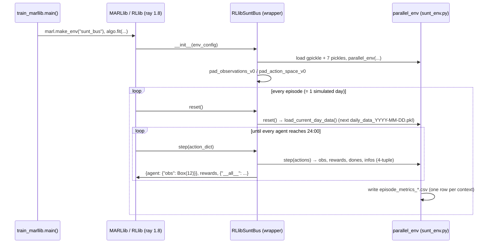

# 01 — BusEnv Architecture Analysis

> Workstream A. Every statement marked **[V]** was checked directly in the source code or data files (file:line refers to branch `retrieval-augmented-rl`, commit `d2b6a8f`). **[I]** marks an interpretation. **[Q]** marks an open question.

## 1. Repository at a glance

| Item | Location | Notes |
|---|---|---|
| Environment | `src/envs/sunt_env.py` (3,566 lines) | One class `parallel_env(ParallelEnv)` with all simulation logic, plus reward classes `DefaultReward` and `DefaultStopClass` in the same file **[V]** |
| MARLlib training entry point | `src/pipelines/train_marllib.py` | Defines the `RLlibSuntBus(MultiAgentEnv)` wrapper and registers it as `ENV_REGISTRY["sunt_bus"]` (`train_marllib.py:61`, `:258`) **[V]** |
| Evaluation entry point | `src/pipelines/evaluate_marllib.py` | Contains a **second copy** of the `RLlibSuntBus` wrapper (`evaluate_marllib.py:63`) **[V]** |
| Other trainers | `train_rllib.py`, `train_custom_a2c.py`, `train_marllib_a2c.py` | Legacy or alternative paths |
| Data pipelines | `src/pipelines/generate_*.py` | Raw SUNT parquet → pickles in `src/training_observation/` |
| Forecasting | `src/Route-Flow-Forecaster-main/` | TimesFM, naive and quantum occupancy forecasts, used when `occupancy_source != "real"` |
| Analysis tools | `src/tools/` | AUC per context or run, Pareto plots, tables |
| Runtime stack | conda env `marllib` | Python 3.8.20, ray 1.8.0, gym 0.20.0, PettingZoo 1.12.0, SuperSuit 3.2.0, torch 1.9.0, numpy 1.20.3, pandas 2.0.3, marllib 1.0.3 **[V]** (`pip list`). `pyproject.toml` pins the same versions. |

No retrieval, RAG, FAISS or BM25 code exists anywhere in BusEnv **[V]** (grep).

> ⚠️ **Environment setup dependency [V].** `marl.make_env("sunt_bus")` needs `MARLlib/marllib/envs/base_env/config/sunt_bus.yaml`. The `MARLlib/` folder in this repository is **empty**. Working copies of the yaml exist at `/mnt/ssd1/wesley/BusEnv/MARLlib/...`, `/mnt/ssd1/lucas/...` and `/mnt/ssd1/tercio/...`.

> ⚠️ **Hard-coded absolute paths [V].** `sunt_env.py:159` (daily data), `:172–176` (quantum, prediction and rate data), `:221` (metrics CSV) and `:238` (climate) all point to `/mnt/ssd1/wesley/BusEnv/...`. These paths are currently reachable. Any new module should take its paths from configuration instead.

## 2. Execution lifecycle

- **Episode = one operational day [V].** Every agent starts at 06:00 (`sunt_env.py:358`). An agent becomes `finished` once its own clock reaches 24 h (`:1243–1255`). On the next `reset()`, the environment advances to the next daily file in round-robin order (`:391–401`). With 183 daily files (2024-03-01 → 2025-03-14) **[V]**, consecutive episodes cycle through the days in order.
- **Asynchronous clocks [V].** Each agent has its own `agent_times[agent]`. WAIT adds 60 s and MOVE adds the edge travel time, so a single env step advances agents by different amounts of simulated time.
- **`step()` returns the old 4-tuple** `(obs, rewards, dones, infos)` (`:1499`). The wrapper relies on this format.
- `train_marllib.py` runs **25 agents**, 5 per route (`:97–125`). It uses `share_policy="individual"`, a `"mlp"` core with `"128-128"` encoder layers, `timesteps_total=200000`, and 10 workers (`:336–347`) **[V]**. CodeCarbon logs show runs of about 15–25 min each on 64 CPUs (`codecarbon/emissions.csv`, median 0.18 h) **[V]**.

## 3. Agents and routes

- **Agents** are `agent_0 … agent_{N-1}` (`:47`). Each one is permanently assigned to one real trip pattern from `real_routes.pkl`, which holds 668 trip_ids → ordered stop lists **[V]**.
- **Route assignment [V].** `manual_route_groups` (`:286–292`) pins 25 agents to 5 trip_ids: `20005_1719_10`, `20015_1413_1`, `20041_1230_10`, `30013_120_10` and `20002_1367_5`. The first four are flagged as near the road works "Batatinha" and "Duda Mendonça" (`:297–308`). Any remaining agents are assigned automatically in blocks of `agents_per_route` (`:446–485`).
- **Movement [V].** A bus moves back and forth along its route, reversing at both ends (`:760–779`). It **cannot leave its route**. The only off-route action is the service-center diversion.
- **Coordination [V].** No messages are exchanged between agents. Coordination is implicit, through two channels:
  1. The signed, normalized time gap to the leader and follower on the same route, used as observation features 10–11 (`_compute_pairwise_headway_gaps`, `:1743–1799`; `_normalize_headway_gap`, `:1801–1812`).
  2. The pairwise sync term in the reward (`getObjectives`, `:2826–2829`).

  Agents serving the same stop on the same route also share a passenger queue (`stop_waiting_passengers[(route_id, stop)]`, `:831–847`). If one bus boards passengers, the next bus finds the queue depleted.

## 4. Observation space (`Box(12,)`) — `sunt_env.py:1503–1534`, built at `:585–598` (reset) and `:1276–1289` (step)

| # | Feature | Source in code | Data provenance |
|---|---|---|---|
| 0 | time of day / 24 h | `agent_times` | simulation clock |
| 1 | occupancy | `state["occupancy"]` | simulated queue model (§6) |
| 2 | travel time to next stop / 3250 | `avg_travel_time_AB[(curr, next)]` | daily pickle `avg_travel_times`, from OD `stop_time` differences |
| 3 | `future_demand_at_B` (**not normalized**, upper bound 1e6) | `future_demand_at_B[str(next)]` | daily pickle `future_demand` = count of Boarding records per stop for that day, capped at 150 (`generate_daily_data.py:130–135`). It is a **whole-day count, not route-specific and not hour-specific**. |
| 4 | uptime | `state["uptime"]` | decays with simulated time; the service center restores it |
| 5 | maintenance ok | `state["maintenance_status"]` | always "ok" in practice |
| 6, 7 | current and next node index (raw integer, 0…2870) | `node_to_idx` | GTFS graph |
| 8 | is_raining | INMET hourly `precip > 0` | `climate_data_2.pkl`. Only used when `use_rain=True`; the training script sets `False`. |
| 9 | occ_risk_out | `_compute_occ_risk_for_agent` (`:1579–1624`) | see the caveat below |
| 10, 11 | headway leader / follower, in [-1, 1] | pairwise gap | simulation |

**Caveats found [V]:**
- `_compute_occ_risk_for_agent` reads `state.get("route_id")` (`:1599`), but `agent_states` never contains a `route_id` key (`:520–531`). The route-level forecast lookup therefore always misses and falls back to `occupancy_rate.get(int(node))` (`:1617`). In the daily pickles, `occupancy_rate` is keyed by **str** stop_ids (checked on `daily_data_2024-03-01.pkl`), so the int lookup also misses and returns 0.0. A value of 0.0 is outside the [0.6, 0.9] band, so feature 9 is probably a constant 1.0 under daily data. **[I]** This should be confirmed at runtime; it does not block the RAG work, but it is a free improvement to report to the team.
- Feature 3 has no upper normalization, and features 6–7 are raw indices. The MLP sees them on very different scales.
- `reset()` reads `uptime_normalized.get(agent)` (`:590`), but that dict is keyed by **vehicle ids** (e.g. `'20161'`), so it always falls back to 1.0.

## 5. Action space — `Discrete(3)` (`:1537–1538`)

| a | Meaning | Effect [V] | Reward [V] |
|---|---|---|---|
| 0 | WAIT | +60 s, uptime and fuel decay (`:749–757`) | **0** |
| 1 | MOVE | advance one stop (reversing at ends), passenger queue update, headway log (`:760–1138`) | `getReward` or `getRewardLexicographicHybrid` |
| 2 | SERVICE_CENTER | shortest path to `service_center_node` (a **random node**, `:110`; `get_nearest_service_center` is not implemented, `:1834–1836`); refuels, uptime +0.3 (`:1141–1183`) | **0** |

The decisions the policy can make today are **holding (WAIT vs MOVE)** and **maintenance timing**. Route choice, skipping stops, speed control and dispatching are **not implemented** **[V]**. Retrieved information can therefore only improve *holding and maintenance decisions on fixed routes*. Using it for route choice would require changing the action space and the transition logic (out of scope, see §10).

## 6. Transition and demand model (MOVE, `occupancy_source="real"`) — `:798–858`

1. Travel time = `avg_travel_time_AB[(curr, next)]` from **today's daily pickle**, capped at 1,800 s (`:782–783`).
2. The queue at `(route_id, next_stop)` grows by `arrival_rate × elapsed`, where `arrival_rate = mean_boardings / mean_intervisit_sec` (`_get_arrival_rate`, `:1684–1688`).
3. Alighting = onboard × `mean_alight_frac`; boarding = `min(queue, remaining capacity)` with capacity 80 (`:840–849`).
4. Both statistics come from `stop_passenger_flow.pkl` through a five-level lookup that falls back to coarser levels (`_get_flow_stats`, `:1630–1682`): `by_route_stop_hour → by_route_stop → by_stop_hour → by_stop → global`. Route-specific levels are used **only on the forward leg**.

> **Key verified fact for the RAG design.** Passenger demand dynamics depend only on **(route, stop, hour, direction)**, through a table aggregated over the **whole period** (`stop_passenger_flow.pkl` is not per day). Only **travel times** vary from day to day. Retrieving "similar historical days" for demand would therefore add information that the simulator itself ignores. The information that actually drives future reward is **downstream along the agent's own route at the current hour**: next stops' arrival rates and alighting fractions, and next edges' travel times. That information is **not** in the 12-dimensional observation (feature 3 is a daily whole-stop count for the next stop only).

## 7. Reward — `DefaultReward` (`:2249–3563`)

- `getObjectives` (`:2771–2902`) returns four scores in [0, 1]:
  - `occupancy_score` = 1 − quadratic penalty outside [0.6, 0.9]
  - `uptime_score`
  - `sync_score`, from the pairwise headway against a 600 s target
  - `efficiency_score` = 1 − estimated/expected time, with a 90 s tolerance
- `scalarize` (`:2950–3009`) computes a weighted average, clipped to [-1, 1]. `getRewardLexicographicHybrid` (`:3011–3065`) blends that average with a lexicographic priority term that depends on the context (`context_priority`, `:2323–2330`; contexts are `normal`, `rain`, `obras` (road works) and `obras_chuva` (road works plus rain), `:738–745`).
- Reward is computed **only on MOVE**. WAIT and SERVICE_CENTER return 0.
- `train_marllib.py:97` sets `weight_vector = {"occ_penalty": 0.0, "uptime_bonus": 1.0, "sync_score": 0.0, "energy_efficiency": 0.0}`. The adjacent tag string reads `"occ1_up0_sync0_eff0"` (`:98`), which **contradicts** the weights **[V]**. Experiments must pin and record the weight vector explicitly.
- `getObjectives` is called twice per MOVE (once inside `getReward` and once inside `getVectorReward`), so `episode_occupancy_values` and the ideal-occupancy flags get two entries per move **[V]** (`:1078`, `:1080`, `:2835–2842`). This does not change the percentage, but is worth knowing.

## 8. Data sources and provenance

Raw SUNT parquet is available at `/mnt/ssd1/wesley/BusEnv/SUNT/tmp/{OD,Boarding,LTI,AVL,AFC,Alighting,GTFS}` (254 OD days) **[V]**.

| Derived artifact | Generator | Raw fields used [V] | Granularity |
|---|---|---|---|
| `viz/graph_gtfs_fev_2024.gpickle` | GTFS Feb-2024 | stops lat/lon, edges `distance` | DiGraph with 2,871 nodes and 4,526 edges |
| `real_routes.pkl`, `route_metadata.pkl` | `generate_real_routes.py` | OD `vehicle`, `trip_number`, `route_short_name`, `direction_id`, `stop_id` | 668 trip patterns, metadata `{route_short_name, direction_id, vehicle, trip_number}` |
| `daily/daily_data_YYYY-MM-DD.pkl` (183) | `generate_daily_data.py` | OD `stop_time` (edge Δt), OD `loading`, Boarding count per `stop_id`, LTI `start_trip`/`end_trip` | per day: `avg_travel_times[(a,b)]`, `future_demand[stop]`, `occupancy_rate[stop]`, `uptime_normalized[vehicle]` |
| `stop_passenger_flow.pkl` | `generate_passenger_flow_stats.py` | OD `n-boardings`, `n-alighting`, `lag_loading`, `stop_time`, `route_short_name`, `direction_id`, `stop_id` | `by_route_stop_hour` (341,886 keys), `by_route_stop` (20,765), `by_stop_hour` (58,193), `by_stop` (2,859), `global`; `min_bucket_count=3` |
| `avg_travel_time_AB.pkl`, `travel_time_stats.pkl` | `generate_observations.py` | OD `stop_time` per consecutive pair, filtered to 120–1,800 s, IQR | 4,489 edges; stats `{mean, median, std, count, original_count, outliers_removed}` |
| `demand_stats.pkl`, `future_demand_at_B.pkl` | `generate_observations.py` | Boarding records per stop per day (cap 150) | 2,931 stops |
| `hourly_stop_activity.pkl` | `generate_observations.py:179–180` | Boarding `stop_time.hour` counts | stop → {hour: count} |
| `occupancy_rate.pkl`, `occupancy_stats.pkl` | `generate_observations.py` | OD `loading` / 80 | 2,869 stops |
| `climate_data/climate_data_2.pkl` | INMET A401 Salvador CSV | `precip` and 17 other weather columns, hourly | 15,336 h |
| `route_obras_proximity.csv` | (notebook) | GTFS geometry vs road-work locations | trip_id → distance to each road work (m), near flag |
| `exports_rates/`, `prediction/`, `quantum_data/` | Route-Flow-Forecaster | OD rates | only 7 trip_ids |

Notes:
- OD `n-boardings` are **fractional** (e.g. 8.918), i.e. estimated by the SUNT origin–destination inference rather than raw counts **[V]**. Any chunk built from them should carry that caveat.
- GTFS stop and route names are the only natural-language fields, which matters for text-based retrieval (doc 04 §3.2).
  - Use the **full** feed at `SUNT/tmp/GTFS/BUS/stops.txt` and `routes.txt`, the same files as `SUNT/data/raw/GTFS_INTEGRA_SALVADOR2/`. **`SUNT/data/stops.csv` and `route.csv` are 5-row samples** [V].
  - `stop_name` is a reverse-geocoded address (street, number, neighbourhood, postcode). It matches 225 of the 226 study-route stops and 2,851 of the 2,871 graph nodes on `stop_id`.

## 9. Integration points (from least to most invasive)

| Option | Where | Change to `sunt_env.py` | Assessment |
|---|---|---|---|
| **A. Observation wrapper around `parallel_env`** | new module `src/rag/` plus a few lines in `RLlibSuntBus.__init__` (`train_marllib.py:102–126`) and in the copy in `evaluate_marllib.py` | **none** | **Recommended.** The wrapper derives `observation_space` from `self.env.observation_space(agent)` (`train_marllib.py:139–144`), so a wider `Box(12+K)` propagates automatically to MARLlib. The wrapper can read the env's public attributes (`agent_states`, `agent_times`, `agent_route_id`, `date`, `obras_routes`, `obras_windows`, `use_rain`/`climate_data`). |
| B. Optional hook inside `parallel_env` | an `obs_augmenter=None` argument applied after `:598` and `:1289`, plus `observation_space` | ~15 lines | Cleaner if the team wants the feature in the core env; must keep `None` as the default to preserve behaviour |
| C. Reward or action changes | `DefaultReward`, `step()` | large | Not needed for Phase 1 |

Option A requires one detail: `pad_observations_v0` wraps the env, so the RAG wrapper should sit **between** `parallel_env` and SuperSuit. It must also override `observation_space(agent)` so that SuperSuit pads to the new size.

## 10. What retrieval can and cannot influence

- ✅ **Holding** (WAIT vs MOVE), for headway regularity and the occupancy band. Example: knowing that the next 5 stops have high arrival rates at this hour and long edges.
- ✅ **Maintenance timing** (SERVICE_CENTER), e.g. knowing the cumulative downstream travel time before the end of the route.
- ✅ **Demand awareness beyond the next stop.** Today's observation covers only the next stop, with a daily count.
- ✅ **Context awareness** (rain, road works), which exists in the reward context but only partly in the observation (feature 8; no road-works flag).
- ❌ **Route choice, stop skipping, dispatching new buses.** These are not in the action space.
- ❌ **Day-specific demand variation.** The simulator's demand is static per (route, stop, hour). Day-analog retrieval of demand would not match the simulator's own dynamics unless the simulator is changed (doc 07, Phase 3).

## 11. Files a Phase 1 implementation touches

| File | Change | Required? |
|---|---|---|
| `src/rag/` (new) | chunk builder, retriever, selector adapter, featurizer, wrapper | yes |
| `src/pipelines/build_rag_index.py` (new) | offline chunk and index construction | yes |
| `src/pipelines/train_marllib.py` | wrap env when `RAG_MODE != "off"` (read from env var or `env_config`) | yes, about 10 lines |
| `src/pipelines/evaluate_marllib.py` | same wrapping | yes, about 10 lines |
| `src/envs/sunt_env.py` | **none** | — |
| `DefaultReward`, action space, MARLlib configs | **none** | — |

## 12. Open questions

- **[Q1]** Should Phase 1 also fix the `occ_risk` key bug (§4)? Doing so changes the baseline, so it must be applied to **all** arms or to none.
- **[Q2]** Train/test day split. The environment currently cycles through all 183 days, so there is no held-out evaluation set. Phase 1 needs a split, e.g. 2024-03 → 2024-12 for training and 2025-01 → 2025-03 for testing (doc 06).
- **[Q3]** Which reward weight vector is the "official" one for the experiment, given the mismatch between the weights and the tag at `train_marllib.py:97–98`?
- **[Q4]** Can `sunt_bus.yaml` be committed to the BusEnv repository (or documented), so that results can be reproduced without other users' folders?
