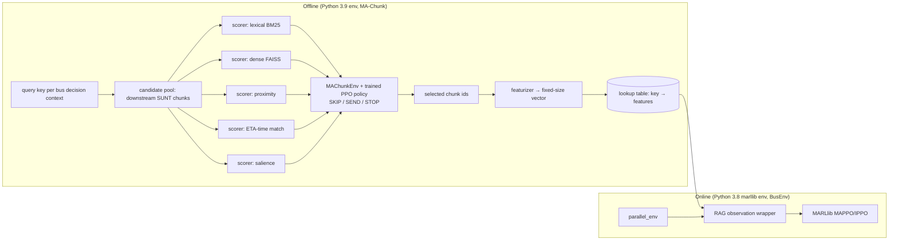

# 02 — RL-Chunk and MA-Chunk: Implementation Analysis and Adaptation to BusEnv

> Workstream B. Paths are relative to `/mnt/ssd1/rafael/git_rl_chunk/`. **[V]** = verified in code or docs (file:line). **[I]** = interpretation or recommendation. **[Q]** = open question.

## 1. Which implementation is current

| Code base | Status [V] |
|---|---|
| `RL-Chunk/src/rl_pipeline/` | Original single-agent **RL-Chunk** (CRAG, SB3 PPO/DDPG/SAC/RecurrentPPO) |
| `RL-Chunk/src/ma_chunk/` | MA-Chunk "v3", now superseded: 3 reward modes, no attribution labels |
| `RL-Chunk/src/ma_chunk_v4/` | MA-Chunk v4 |
| **`MA-Chunk/` repository** (commit `3948cc7`, "code release for AAMAS 2027") | **Reference implementation.** Same behaviour as v4: the `"v3"` utility mode was renamed `"useful"`, paths come from env vars, and package imports are used. |

**Recommendation [I]: use both methods as two adaptive-selection arms over the same candidate pools.**
- **B5a = RL-Chunk**, single-agent: a sequential walk with SELECT/SKIP and a label-free reward.
- **B5b = MA-Chunk**, multi-agent: scorers as agents with SKIP/SEND/STOP, trained from labels.

Both are reused from their repositories. Comparing them inside BusEnv is a contribution in its own right (hypothesis H5, doc 06): does MA-Chunk's advantage on QA carry over to a control setting?

Notes on RL-Chunk from the project's own diagnosis:
- In QA, the original RL-Chunk "degenerates into a myopic filter" (`RL-Chunk/aamas/BARREIRAS.md`, entry B1):
  - it walks through the chunks in document order;
  - it visits only 15–80 of about 1,450 chunks;
  - only 4–7% of its picks are in the top-10;
  - PPO and R-PPO always select 10 chunks, with standard deviation 0.
- Entry B9 records that its main signal (spaCy cosine) has AUC 0.417 for usefulness, which is worse than random.
- **In BusEnv, both weaknesses are reduced [I]:**
  - The walk order can be the **route order** (nearest downstream stop first). There, "myopic" is semantically correct: nearer stops matter sooner.
  - Each pool has about 40 candidates, not about 1,450.
  - The similarity signal can be replaced by a multilingual dense score (doc 04 §5.3).

  Whether RL-Chunk still collapses to "always K_max" must be checked (doc 07, Step 6a test).

## 2. RL-Chunk (single-agent) in brief [V]

| Aspect | Implementation |
|---|---|
| Data | CRAG, 50 questions × 5 domains (`src/rl_pipeline/config.py:98`); columns `domain, query, page_results_text` (`train.py:55`) |
| Chunks | Text, packed greedily from sentences up to 500 characters (`config.py:37`, `env.py:98–111`); no stored embeddings |
| Candidates | No retrieval stage: the whole page is chunked and visited in document order (`env.py:1–5,119`) |
| Observation | `Dict` of 3 scalars: spaCy similarity, normalized BM25, remaining budget (`env.py:184–188`) |
| Action | `Discrete(2)` skip/select, or a `Box` thresholded at 0.5 (`env.py:189–192`) |
| Stop | Implicit: end of page or 10 selected (`env.py:251–254`); no STOP action |
| Reward | `graduated_reward(cos + 0.3·BM25) − 0.5·1.4^n_selected` (`env.py:240–244`). No LLM and no labels; the reward is the same signal the agent observes. |
| Training | SB3, 40k steps, seed 42 (`train.py:77–94`) |
| Evaluation | OpenAI reader, then ROUGE/BLEU/BERTScore/RAGAS. The RAGAS columns in the final table are invalid because of a column bug (`aamas/BARREIRAS.md:15–22`). |
| Coupling | `config.py:30–34` raises an error at import if `OPENAI_API_KEY` is missing, and `env.py` imports `config`. |

### 2.1 Adapting RL-Chunk to BusEnv (arm B5a) [I]

RL-Chunk's environment is **reusable with a small subclass**. `ChunkSelectionEnv` (`env.py:164–276`) gets its per-row data only through `_chunks_and_scores(row_idx, row) -> (chunks, similarity[], bm25[])` (`env.py:213–220`) [V]. A BusEnv subclass overrides that one method to return, for each query key:
- `chunks`: the candidate chunk ids, in **route order** (hops ahead), which is RL-Chunk's "document order";
- `similarity`: the **dense** score of doc 04 §5.3, min-max scaled to [0, 1] per key. It replaces spaCy `en_core_web_md`, which is English-only, while the SUNT chunk text is Portuguese (stop names, doc 04 §3.2);
- `bm25`: the BM25 score, normalized by the per-key maximum, exactly as `compute_bm25_scores` does (`env.py:78–95`).

Everything else is used **unchanged**:
- the observation `{similarity, bm25_score, remaining_budget}`;
- the actions (`Discrete(2)`, or continuous for DDPG/SAC);
- the label-free reward `graduated_reward(cos + 0.3·BM25) − 0.5·1.4^n` (`env.py:240–244`, `config.py:58,88–89`);
- the budget `MAX_SELECTED_CHUNKS` (set to K_max);
- `train.py`'s SB3 setup (PPO, R-PPO, DDPG, SAC; 40k steps; seed);
- `run_episode` for inference (`env.py:279–310`).

The RL-Chunk "domain" maps naturally to the **route (`trip_id`)**. RL-Chunk trains one model per domain (`train.py:107`), which here gives one model per route, i.e. 5 models.

Practical details [V]:
- `config.py:30–34` raises an error at import if `OPENAI_API_KEY` is unset. No OpenAI call is made during training or selection, so set a dummy value (`OPENAI_API_KEY=unused`) rather than editing RL-Chunk.
- `env.py` imports spaCy and loads `en_core_web_md` lazily (`get_nlp`, `env.py:29–32`). The subclass never calls it, but spaCy must be installed.
- Run it in the same Python ≥ 3.9 offline environment as MA-Chunk (gymnasium 1.1.1, SB3 2.6).

Ablation **A12** (doc 06) replaces RL-Chunk's similarity-based reward with the L1-label reward (`useful − cost`). This separates "RL-Chunk's architecture" from "RL-Chunk's proxy reward".

## 3. MA-Chunk (reference) [V]

### 3.1 Pipeline
1. `ma_chunk.candidates` scores every chunk with 5 retriever "agents":
   - `bm25`
   - `spacy`
   - `minilm` (all-MiniLM-L6-v2)
   - `e5` (e5-base-v2)
   - `ce` (ms-marco cross-encoder)

   The pool is the union of each agent's top-8 (`candidates.py:172–208`). Dense scoring is brute-force; **FAISS is not used**.
2. `ma_chunk.labels` produces binary `useful` labels per chunk. For CRAG these come from an LLM judge that sees the gold answer (`labels.py:23–47`). For HotpotQA/MuSiQue they come from the gold supporting facts, with **no LLM** (`multihop_data.py`).
3. `ma_chunk.train_ma` trains with PPO, A2C, DQN or RecurrentPPO, using 5-fold CV stratified by domain (`train_ma.py:173–260`). **Training makes no LLM call.**
4. Evaluation: a frozen reader plus a CRAG judge, the abstention gate, and RAGAS.

### 3.2 Environment `MAChunkEnv` (`ma_chunk/env_ma.py`)
- **Structure:** a Dec-POMDP run as turn-based AEC inside a single-agent Gymnasium env. One policy is shared by all agents, and the agent one-hot is part of the observation (`env_ma.py:1–5`).
- **Agents = retrievers (scorers).** Each walks its own top-`top_m` list (`env_ma.py:73–77`).
- **Actions:** `SKIP=0`, `SEND=1` (add the chunk to the shared channel), `STOP=2` (`env_ma.py:43`).
- **Termination:** all agents stopped or exhausted, or channel tokens ≥ `token_budget` (2,000), or channel size ≥ `max_chunks` (10) (`env_ma.py:235–237`).
- **Observation:** `Box(2N+11)`, i.e. 21 for N=5 (`env_ma.py:44,50–51`):
  - agent one-hot;
  - retriever scores of the current chunk (other agents' scores only when `share_scores`, i.e. "messages");
  - own score;
  - list pointer;
  - agreement (fraction of other agents that have the chunk in their top-M);
  - **redundancy** (max cosine of `emb` with chunks already in the channel);
  - channel tokens and size;
  - own and others' sends;
  - progress;
  - token length;
  - empty flag.

  **No text and no query vector enter the observation.**
- **Reward** (`env_ma.py:257–282`): team objective `R = U(S) − λ·tokens(S)/1000`, paid as marginal contributions `ΔU − λ·tokens(c)/1000` on each SEND. `U = min(1, n_useful / max(1, n_support, support_floor))` (`:239–240`). The marginal rewards add up exactly to R (property test `tests/test_rewards.py`).
- **Input contract** `QueryData(pool, top_m, agents, universe)` (`env_ma.py:57–89`). It needs a DataFrame with one row per candidate and the columns:
  - `interaction_id, chunk_id, text, tokens, emb`;
  - `s_<agent>` and `rank_<agent>` for each agent;
  - optionally `useful` and `n_support`.

  **The set of agents is a parameter**, so any number of non-text scorers works.
- **Training cost:** about 16 min and 4 Wh per 5-fold run on one CPU core. Inference takes 4.8–8.2 ms per query (`paper/generated/sustainability.tex`, `docs/REPRODUCE.md`). The network is `net_arch=[64,64]` with `gamma=1.0` (`train_ma.py:113–129`).
- **Baselines included** (`baselines.py`, `sup_select.py`):
  - `topk_<agent>_<k>`, `rrf_<k>`, `oracle`;
  - supervised logreg/GBM with a greedy expected-gain ≥ cost rule;
  - the `single` RRF agent;
  - a threshold gate.
- **Documented results** (`MA-Chunk/README.md`, `paper/generated/*.tex`), quoted, not reproduced here:
  - team reward +0.015 over the centralized single agent (15/15 clusters, p_Holm < 0.001);
  - a misleading retriever sends ≤ 2% of messages;
  - failure-aware training cuts the worst-case loss by 61–95%;
  - on CRAG, MA-Chunk-P (λ=0.4) uses 2.8 chunks for RAGAS-5 = 0.492, against about 10 chunks and 0.413–0.447 for the RL-Chunk policies.

### 3.3 Dependencies [V]

| | MA-Chunk | BusEnv (`marllib` conda env) |
|---|---|---|
| Python | ≥ 3.9 (3.9.20) | 3.8.20 |
| RL | gymnasium 1.1.1, stable-baselines3 2.6.0, sb3-contrib 2.6.0 | gym 0.20.0, ray[rllib] 1.8.0, MARLlib 1.0.3 |
| torch / numpy | 2.3.1 / 1.26.4 | 1.9.0 / 1.20.3 |
| Retrieval | rank-bm25, sentence-transformers 4.1.0, spaCy 3.8.5 | none |

**They cannot share one Python environment [V]** (the Python and numpy pins conflict). This shapes the design: run MA-Chunk **offline, in its own environment**, and hand BusEnv only precomputed numeric artifacts (§5).

## 4. Mapping MA-Chunk onto BusEnv

### 4.1 Concept mapping [I]

| MA-Chunk concept | QA meaning | BusEnv meaning |
|---|---|---|
| Query | Natural-language question | The **decision context** of one bus: `(trip_id, route position, direction, hour, day type, rain flag, road-works flag)` |
| Candidate chunk | Text passage | A **structured SUNT record** along the bus's downstream route: stop×hour demand, segment travel time, stop activity (doc 04) |
| Retriever agents | BM25, spaCy, MiniLM, E5, cross-encoder | **SUNT scorers**: lexical (BM25 over the record's text rendering), dense (FAISS/MiniLM over the same text), route proximity, ETA-time match, salience (\|z-score\|), sample support |
| `tokens` (cost) | LLM tokens | Feature cost: 1 per chunk (count budget) or the number of feature dimensions |
| `emb` (redundancy) | MiniLM vector | Normalized numeric vector of the chunk's fields (type, position, value), so redundant chunks are detectable |
| `useful` label | LLM judge / gold support | **Proxy label, no LLM** (§4.3) |
| Reader + judge (evaluation) | LLM answer quality | **Downstream MARL performance** in BusEnv (doc 06) |
| Gate (ANSWER/ABSTAIN) | Abstention | Optional "use context or not" bandit (Phase 3) |

### 4.2 Does MA-Chunk's multi-agent structure match BusEnv's buses? [I]

**Not directly.** MA-Chunk's agents are *scorers taking turns inside one selection episode*. BusEnv's agents are *buses acting at the same time in the world*. The simplest faithful mapping keeps the two levels separate:



Each bus receives its own context vector at each decision step. That vector is the output of an MA-Chunk episode in which the **scorers** are the agents. A design where "every bus is an MA-Chunk agent writing to a fleet channel" would need a new environment and joint training; it belongs in Phase 3 (doc 07).

### 4.3 The `useful` label without an LLM

MA-Chunk's environment trains from any binary `useful` column [V by construction, `env_ma.py:63`]. For BusEnv, two LLM-free label definitions are proposed. Both are documented transformations of existing data.

- **L1 — deviation coverage (default, Phase 1).** For a query q with candidate set C(q) inside horizon H, compute each chunk's deviation `d_c = |v_c − v̄_{type,route,hour}| / σ_{type,route,hour}`. Here v is the chunk's statistic (expected boardings, alighting fraction or travel time) and v̄, σ are the route-hour mean and standard deviation. Sort by `d_c × w(hops)`, where w is a decreasing weight for distance ahead. Mark as useful the smallest prefix that covers ≥ 80% of the total weighted deviation. `n_support` is the size of that prefix.
  - *Rationale:* chunks that make the downstream route different from what a "typical" route at this hour looks like are the information that time-of-day and position alone cannot provide.
  - *Risk:* L1 partly overlaps with the salience scorer. The policy still has to learn the interaction with proximity, ETA and redundancy, and the downstream MARL test is the real judge (doc 06).
- **L2 — downstream-outcome attribution (Phase 3).** Log rollouts of the B0 policy. Label a chunk useful if its stop or segment is where the realized occupancy-band violation, headway deviation or efficiency loss occurred within the next H steps. This ties labels to BusEnv's reward but couples them to a particular policy.

### 4.4 What is reused, adapted, or dropped

| Component | Decision |
|---|---|
| `env_ma.py` (`MAChunkEnv`, `QueryData`) | **Reuse as-is**, in the MA-Chunk environment (Python 3.9). Only the input DataFrame changes. |
| `train_ma.make_model`, `rollout`, K-fold loop | **Reuse.** Replace domain stratification with route (`trip_id`) stratification. |
| `baselines.py` (top-k, RRF, oracle) | **Reuse** for the retrieval-quality metrics and for baseline arms B2–B4 |
| `sup_select.py` (logreg/GBM + greedy) | **Reuse** as a strong non-RL selector (ablation A6) |
| `candidates.build` | **Adapt:** new scorers over SUNT chunks, keeping the `s_*/rank_*/tokens/emb` schema |
| `labels.py`, `attr_labels.py`, `reader.py`, `eval_reader.py`, `ragas_*`, `llm*.py` | **Drop** (QA-specific, need an LLM) |
| `gate.py` | **Concept only**, for Phase 3 |
| Pretrained `.zip` policies (both projects) | **Drop.** They were trained on QA score distributions; retraining is cheap (CPU, minutes). |
| RL-Chunk `env.py` (`ChunkSelectionEnv`, `graduated_reward`, `run_episode`) | **Reuse via subclass** (§2.1): override `_chunks_and_scores` only |
| RL-Chunk `train.py` / `infer.py` | **Reuse** (SB3 setup, per-domain = per-route models, `PPO.load` for selection) |
| RL-Chunk `llm.py`, `llm_cache.py`, `generate_responses.py`, `compute_metrics.py`, `faiss_encoreweb.py` | **Drop** (QA reader and metrics; the FAISS baseline is rebuilt over SUNT chunks in doc 04) |

### 4.5 Adapter interface (for the implementing agent)

```python
# --- runs in the MA-Chunk env (py>=3.9), offline ---
def build_pool(query_key: QueryKey, chunks: pd.DataFrame, scorers: list[Scorer], top_m: int = 8) -> pd.DataFrame:
    """Return a QueryData-compatible pool: interaction_id=str(query_key), chunk_id, text, tokens(=1),
    emb (L2-normalized numeric vector), s_<scorer>, rank_<scorer>, [useful, n_support]."""

def select_machunk(policy_path: str, pool: pd.DataFrame, agents: list[str], lam: float, max_chunks: int) -> list[int]:
    """PPO.load(policy_path, device='cpu'); roll one deterministic MAChunkEnv episode
    (as train_ma.rollout, train_ma.py:139-160); return selected chunk_ids."""

class BusChunkSelectionEnv(rl_pipeline.env.ChunkSelectionEnv):   # RL-Chunk, unchanged otherwise
    def _chunks_and_scores(self, row_idx, row):
        """row = one query key; return (chunk_ids in route order, dense_sim[0,1], bm25_norm[0,1])."""

def select_rlchunk(model_path: str, pool_row: pd.Series, algo: str = "ppo") -> list[int]:
    """PPO.load(model_path); rl_pipeline.env.run_episode(...) on BusChunkSelectionEnv; return selected chunk_ids."""

# --- pure numpy, shared by both envs ---
def featurize(selected: pd.DataFrame, spec: FeatureSpec) -> np.ndarray:   # fixed length D
```

### 4.6 Training jointly or separately?

**Train separately in Phase 1 [I].** Each selector trains in its own loop: MA-Chunk from L1 labels, RL-Chunk from its label-free similarity reward. Both take minutes of CPU and need no RLlib. They are then frozen and their selections precomputed. Joint training (selector reward = BusEnv return) would create a two-level optimization across two incompatible software stacks, and would add non-stationarity to MARL training. It is deferred to Phase 3, and only if Phase 1 shows a signal.

## 5. Why precomputation is possible (and preferred)

The query key is **discrete and finite** [I, based on doc 01 §6]:
- trip_id: 5 in the current setup;
- route index: ≤ about 80 stops;
- direction: 2;
- hour: 6–23;
- day type: 3 (weekday, Saturday, Sunday/holiday);
- rain: 2;
- road works: 2.

That gives roughly 5 × 80 × 2 × 18 × 3 × 2 × 2 ≈ 173k keys at most; the actual number is smaller because many combinations never occur. With a context vector of about 10 floats, the table is under 10 MB.

The full MA-Chunk selection can therefore run offline once per arm. The online wrapper then does a **dictionary lookup**. This gives:
- **no hot-loop latency** and **no SB3 or torch-2 dependency** inside RLlib workers;
- **bit-exact reproducibility**: each arm is a file with a hash;
- **identical online cost across arms**, so differences between arms come only from *which* chunks were selected.

Dynamic state (current occupancy, headway) is deliberately **excluded from the query** in Phase 1. It is already in the observation, and including it would prevent precomputation. **[Q]** Adding discretized occupancy bins to the key is a cheap Phase 3 extension.

## 6. Risks specific to the adaptation

1. **The ceiling is set by the scorers and labels, not by the policy.** This is MA-Chunk's own lesson (`BARREIRAS.md` B9). For SUNT, the proximity and ETA scorers are probably strong and BM25 and dense scorers weak. The analysis should report each scorer's AUC against the L1 labels, as `BARREIRAS.md` B9 does.
2. **Label circularity (L1 against the salience scorer).** Mitigation: report per-scorer AUC, run an ablation without the salience scorer, and treat MARL performance as the primary outcome.
3. **Context value may be small** if a simple direct look-ahead feature (baseline B1, doc 06) already captures it. That is a legitimate negative result, and it must be reported.
4. **Dependency drift.** Pin the MA-Chunk commit (`3948cc7`) and record the hash of the precomputed table in each run's config.
