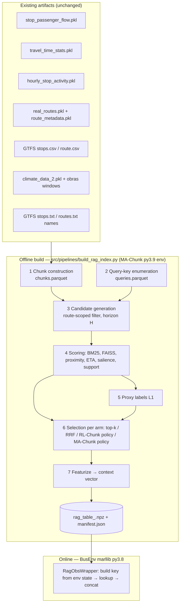

# 04 — RAG Architecture for BusEnv

> Workstream D. **[V]** = verified in code or data, **[I]** = design proposal, **[Q]** = open question. Data facts are taken from doc 01 §8.

## 1. Design principles

1. **Structured first, text second.** SUNT-derived data is numeric and keyed by `(route, stop, hour, edge)`. Chunks are **structured records**. The text rendering of a chunk exists only so that the lexical and dense retrieval baselines that the plan requires can run, and for the optional LLM in Phase 2.
2. **Every chunk field has provenance.** Each field traces to a raw SUNT column through an existing BusEnv pipeline (§3). Nothing is invented.
3. **Everything heavy happens offline.** Chunks, indexes, scoring, MA-Chunk selection and featurization run offline. The online cost is one dictionary lookup per agent per step.
4. **No database and no service.** About 10⁴ chunks fit in memory. FAISS `IndexFlatIP` and `rank_bm25` run in-process, offline, in the MA-Chunk environment.

## 2. Pipeline



## 3. Chunk types (Phase 1)

All chunk types are built from artifacts that BusEnv already loads or ships. Every value is passed through unchanged or aggregated as described.

| Type | Key | Fields | Source artifact → raw SUNT columns [V] |
|---|---|---|---|
| **`stop_hour`** (demand) | `(trip_id, stop_id, hour, direction)` | `mean_boardings`, `mean_alight_frac`, `mean_intervisit_sec`, `count`, `level` (which fallback level answered) | `stop_passenger_flow.pkl` (`by_route_stop_hour` → `by_route_stop` → `by_stop_hour` → `by_stop`), from OD `n-boardings`, `n-alighting`, `lag_loading`, `stop_time`, `route_short_name`, `direction_id`, `stop_id` (`generate_passenger_flow_stats.py`) |
| **`segment`** (travel time) | `(stop_a, stop_b)` | `mean`, `median`, `std`, `count` (seconds) | `travel_time_stats.pkl`, from OD `stop_time` differences between consecutive stops, filtered to 120–1,800 s, IQR (`generate_observations.py:153–171`) |
| **`stop_activity`** (network-level demand) | `(stop_id, hour)` | `n_board_records` (all routes), `share_of_day` | `hourly_stop_activity.pkl`, from Boarding `stop_time.hour` counts (`generate_observations.py:179–180`) |

**The chunk-building code must reproduce the environment's lookup logic exactly**, for example by calling the same cascade as `_get_flow_stats`, `sunt_env.py:1630–1682`. That includes the rule that **route-specific levels are used only on the forward leg** (`:1664–1666`). Otherwise the chunks would describe something different from what the simulator does.

**Context is a query field, not a chunk [I].** Rain (`climate_data_2.pkl` `precip > 0`) and road works (`obras_routes` × `obras_windows`, `sunt_env.py:297–308`) are known exactly at decision time. They act as **filters and conditioning variables** of the query, not as retrievable evidence.

**Not used as chunks in Phase 1, with reasons:**
- **Daily per-edge travel times** (`daily/*.pkl`). Day-specific values would leak the simulator's own travel time for that day, and would multiply the table size by the number of days (183).
- **The quantum, TimesFM and prediction folders.** They cover only 7 trip_ids.
- **LTI uptime.** It is keyed by vehicle, not by route or stop.
- **GTFS `stop_name` free text.** Used only in the text rendering (§5.1).

**Size [V for counts, I for totals].** The 5 routes have 50 + 59 + 60 + 42 + 33 = 244 route positions (226 unique stops) and 239 edges. `stop_hour` chunks number about 244 × 19 hours × 2 directions ≈ 9k, `segment` chunks 239, and `stop_activity` chunks about 244 × 19 ≈ 4.6k. That totals **≈ 14k chunks**, a few MB.

### 3.1 Chunk record schema (`chunks.parquet`)

```
chunk_id:int, type:{stop_hour,segment,stop_activity}, trip_id:str|null, stop_id:str|null,
stop_b:str|null, hour:int|null, direction:{fwd,bwd}|null,
value_main:float, value_aux:float, value_std:float|null, count:int, level:str,
z_route_hour:float,            # deviation from route×hour mean of the same type (for salience)
street:str|null, neighborhood:str|null, cep:str|null, landmark:str|null,   # place fields (§3.2)
lat:float|null, lon:float|null,                                            # from the GTFS graph nodes
text:str,                      # deterministic rendering (§5.1)
emb:float32[d],                # normalized numeric vector (for MA-Chunk redundancy)
provenance:str                 # e.g. "stop_passenger_flow.pkl:by_route_stop_hour"
```

### 3.2 Stop names as place context

Stop and place names can make retrieval meaningful instead of a match on ids and hours. The data supports this, with caveats.

**What exists [V]:**
- GTFS `stops.txt` (`/mnt/ssd1/wesley/BusEnv/SUNT/tmp/GTFS/BUS/stops.txt`, the same file as `SUNT/data/raw/GTFS_INTEGRA_SALVADOR2/stops.txt`) has 2,975 rows with `stop_name` and `stop_desc`.
- It matches **225 of the 226** unique stops on the 5 study routes, and 2,851 of the 2,871 graph nodes, on `stop_id`.
- `stop_name` is a **reverse-geocoded address**, not an official stop name, e.g. `"Avenida Ulysses Guimarães 4355-4499 - Novo Horizonte Salvador - BA 41218-700 Brasil"`.
- `stop_desc` holds a landmark or neighbourhood label for 157 stops overall (e.g. `"SUSSUARANA VELHA"`, `"Passeio Publico"`).
- `routes.txt` `route_long_name` gives the route's endpoints and corridor, e.g. 1719 = `"Terminal Águas Claras X Imbuí / Boca do rio (Via Regional)"`, 1413 = `"Boca da Mata x Lapa"`.

**Derived fields** (a documented regex transformation; parse rates checked on the 225 study stops):

| Field | Pattern | Parsed |
|---|---|---|
| `street` | text before the house number | 219 / 225 (119 distinct streets, e.g. *Avenida Luiz Viana* 11 stops, *Via Regional* 11, *Av. Vasco da Gama* 8) |
| `neighborhood` | text between `" - "` and `" Salvador"` | 153 / 225 (57 distinct neighbourhoods, e.g. *São Marcos* 17, *Imbuí* 7, *Pituba* 5) |
| `cep` | Brazilian postcode | 148 / 225 |
| `landmark` | `stop_desc` | partial |

**How names help retrieval [I]:**
1. **Richer text for BM25 and dense scorers.** Chunk and query renderings include street, neighbourhood and landmark (§5.1). Lexical and dense retrieval can then match *places*: same avenue, same neighbourhood, same corridor named in `route_long_name`. Today they would match only ids.
2. **A structural `place` scorer** (§5.3): a corridor-continuity score, 1 if the chunk's stop is on the same street or neighbourhood as one of the next stops on the path, decaying with hops.
3. **Optional `corridor` chunk type** (Phase 1, optional): aggregate `stop_hour` and `segment` statistics by `street` across all 5 routes. *Avenida Luiz Viana* and *Via Regional* appear on several study routes, so these chunks let a bus retrieve demand and travel time observed on the same corridor by other routes. This is a simple, text-keyed form of the cross-route or graph retrieval otherwise deferred to Phase 3.
4. **Semantic stop embeddings.** Dong & Gayah (arXiv:2608.10207, doc 03 §7.2) report that offline semantic stop embeddings improved a bus-holding controller while raw stop ids did not. This is directly relevant because BusEnv's observation contains raw node indices (features 6–7). See ablation A11 (doc 06).
5. **Phase 2 prompts.** Names give the LLM world knowledge (terminals, hospitals, stations), which is also the main hallucination risk (doc 05 §6).

**Caveats [V]:**
- The names are addresses from a geocoder, so the parsing is noisy (e.g. `"Via Coletora B- Cajazeiras"`). About 32% of study stops have no parsable neighbourhood.
- One study stop has no GTFS match.
- **The road-works names in `sunt_env.py` ("batatinha", "duda_mendonca") never occur in any `stop_name`** (0 / 2,975). Road works therefore **cannot be linked to stops by text**; stop-level proximity must come from geometry (graph lat/lon against road-work coordinates). The road-work coordinates exist only inside the notebook that produced `route_obras_proximity.csv` **[Q]**.
- Names carry no transport measurements, so they are used for *matching and grouping*, never as a source of values.

## 4. Query (decision context)

`QueryKey = (trip_id, route_idx, going_forward, hour, day_type, rain, obras)`

Every field is readable from the environment's public state, with no change to `sunt_env.py`:

| Field | Read from [V] |
|---|---|
| trip_id | `env.agent_route_id[agent]` |
| route_idx, going_forward | `env.agent_states[agent]["route_idx"]` and `["going_forward"]` |
| hour | `int(env.agent_times[agent] // 3600) % 24` |
| day_type | `pd.Timestamp(env.date).dayofweek` → weekday, Saturday or Sunday. Holidays: **[Q]** a list is needed |
| rain | `env.climate_data` row lookup, same logic as `sunt_env.py:710–723` (only if `use_rain`) |
| obras | `env.obras_routes` and `env.obras_windows`, same logic as `:730–736` |

**Size [I]:** 244 stops × 2 directions × 18 hours × 3 day types × 2 × 2 ≈ **105k keys**.

## 5. Retrieval

### 5.1 Text rendering (used by BM25, FAISS and the Phase 2 LLM)

```
[stop_hour] linha 1719 (Terminal Águas Claras X Imbuí / Boca do rio (Via Regional)) sentido V
 parada 44783401 | Via Regional | bairro Castelo Branco | hora 07
 embarques médios 2.22 por visita; fração de desembarque 0.03; intervalo entre visitas 1829 s; n=188; nível route_stop_hour
```

The query is rendered the same way, with the place fields of the next stops, e.g. `linha 1719 sentido V próximas paradas: Via Regional (Castelo Branco), Av. ... hora 07 dia útil chuva não obras sim`.
- Rendering in Portuguese keeps the stop-name tokens and the template in one language.
- BM25 tokenization should lowercase and strip accents (`unidecode`).
- Ablation A11 renders the same chunks **without** place fields (ids and numbers only), to measure how much the names help each retriever and selector.

**[I]** Lexical and dense retrieval over these strings are **weak by construction**: they mostly match ids and hour tokens. They are included because the plan asks for them and because MA-Chunk benefits from heterogeneous and even misleading scorers (`BARREIRAS.md` B9). They should not be expected to be the best scorers.

### 5.2 Candidate generation (structured filter)

`C(q)` contains:
- the `stop_hour` chunks for the next **H** stops along the bus's bounce path (`_future_route_indices` logic, `sunt_env.py:1559–1567`), at the **ETA hour** and the ETA hour + 1;
- the `segment` chunks for the next H edges;
- the `stop_activity` chunks for those stops.

ETA is computed by accumulating `segment.mean` along the path. With H = 10, |C(q)| ≈ 10 × 2 + 10 + 10 = **40 candidates**, the same size as MA-Chunk's pools (top-8 × 5 agents).

### 5.3 Scorers (MA-Chunk "agents")

| Scorer | Score | Implementation | Expected strength [I] |
|---|---|---|---|
| `bm25` | BM25(query text, chunk text) | `rank_bm25.BM25Okapi`, accent-folded tokens | weak to medium (stronger with place fields, §3.2) |
| `dense` | cosine(enc(query), enc(chunk)) with a **multilingual** encoder (e.g. `sentence-transformers/paraphrase-multilingual-MiniLM-L12-v2`; English MiniLM or spaCy `en_core_web_md` would mishandle Portuguese street names) | sentence-transformers + **FAISS `IndexFlatIP`** | weak to medium |
| `place` | corridor continuity: 1 if the chunk's `street` or `neighborhood` equals that of one of the next stops, × hop decay | numpy | medium (new, enabled by stop names) |
| `proximity` | 1 / (1 + hops ahead) | numpy | strong |
| `eta` | exp(−\|chunk.hour − ETA hour\|) | numpy | medium |
| `salience` | \|z_route_hour\| | numpy | strong, but see the L1 circularity note in doc 02 §4.3 |
| `support` | log(1 + count) / log(1 + max count) | numpy | weak (reliability prior) |

- **Hybrid** = reciprocal rank fusion (RRF, k = 60) of all scorers, as MA-Chunk's `rrf_<k>` does.
- **Reranking:** a cross-encoder would rerank text and does not apply to structured records. It is **not proposed**; the MA-Chunk policy is the learned "reranker plus stopper".

### 5.4 Is FAISS needed?

The plan asks for FAISS, and it is cheap, but it is not required for scale. Each query's candidate set is about 40 chunks, which brute-force numpy handles. FAISS (`IndexFlatIP`, exact) is used **only to compute the dense baseline scores**, offline, so that the dense arm matches standard practice. No approximate index and no database is justified.

## 6. Selection

| Arm | Selector | Output |
|---|---|---|
| B2 | top-K by `bm25` | K chunks (fixed) |
| B3 | top-K by `dense` (FAISS) | K chunks (fixed) |
| B4 | top-K by RRF hybrid | K chunks (fixed) |
| B5a | **RL-Chunk** policy (SB3 PPO, single agent; walks C(q) in **route order**; observation = dense similarity, BM25, remaining budget; label-free graduated reward; `MAX_SELECTED_CHUNKS = K_max`; one model per route) (doc 02 §2.1) | **variable** ≤ K_max chunks (SELECT/SKIP until the budget or the list ends) |
| B5b | **MA-Chunk** policy (PPO, scorers as agents, `share_scores=True`, price λ, `max_chunks = K_max`) | **variable** ≤ K_max chunks; stops by itself |
| B6 | random K from C(q) | control |

K is set to the median number of chunks selected on the training keys by the **better of B5a and B5b on validation keys**, so the fixed-K arms see the same **average** budget (equal-budget comparison). The chunk counts of both adaptive arms are reported.

## 7. Featurization (from selected chunks to observation)

The MARL policy is an MLP on `Box(12)`. **Text cannot be consumed [V]** (doc 01 §4). Selected chunks are turned into a fixed-length, order-independent vector of **D = 10** dimensions:

| # | Feature | Definition (over selected chunks of the given type) |
|---|---|---|
| 0 | `n_sel / K_max` | how much context was selected |
| 1 | `sum_arrival_rate_norm` | Σ (mean_boardings / mean_intervisit_sec) over `stop_hour`, normalized by its p99 on the training keys |
| 2 | `max_boardings_norm` | max mean_boardings, normalized by p99 |
| 3 | `hops_to_max_boarding / H` | where the peak demand is |
| 4 | `mean_alight_frac` | mean over `stop_hour` |
| 5 | `sum_tt_norm` | Σ segment.mean / (H × 1,800) |
| 6 | `max_tt_z` | max segment z_route_hour, clipped to [-3, 3] / 3 |
| 7 | `tt_cv` | mean(std / mean) over segments (variability) |
| 8 | `activity_share` | mean `stop_activity.share_of_day` |
| 9 | `mask_any` | 1 if at least one chunk was selected, else 0 |

Missing types contribute 0. Every arm, including B1 (direct look-ahead, no retrieval), uses **the same featurizer and the same D**, so only the *selection* differs. A slot-based featurizer (K × fields) is kept as ablation A5 (doc 06).

## 8. Online integration (BusEnv side)

```python
# src/rag/wrapper.py  (pure numpy; runs in the marllib py3.8 env)
class RagObsWrapper(BaseParallelWraper):          # pettingzoo 1.12 base wrapper
    def __init__(self, env, table_path, mode):     # mode in {"off","b0z","lookahead","bm25","dense","hybrid","rlchunk","machunk","random"}
        self.table = np.load(table_path)           # keys -> float32[D]; manifest has hash + arm + H + K
    def observation_space(self, agent):            # Box(12 + D)
    def reset(...) / step(...):                    # obs[a] = concat(obs[a], self.table.get(key(env, a), zeros(D)))
```

- **Position in the wrapper stack:** `parallel_env → RagObsWrapper → pad_observations_v0 → pad_action_space_v0` (`train_marllib.py:126–127`). `RLlibSuntBus` reads the widened space automatically (`:139–144`) **[V]**.
- **Wrapper API detail [V].** PettingZoo 1.12's `BaseParallelWraper.__init__` caches `env.observation_spaces`, which is the **12-dimensional** dict. SuperSuit 3.2's padding wrappers instead call `self.env.observation_space(agent)` (`supersuit/generic_wrappers/utils/shared_wrapper_util.py:16–17`). The RAG wrapper must therefore override `observation_space(agent)` to return `Box(12 + D)` with the bounds concatenated. It should also overwrite `self._observation_spaces` so the deprecated dict stays consistent. `reset()` in the base wrapper takes no `seed`, which matches the 1.12 API that `RLlibSuntBus.reset()` uses.
- **`mode="off"`** means no wrapper, so behaviour is bit-identical to the current BusEnv.
- **Missing key** (e.g. an unseen hour) → zeros, plus a counter in `infos`.
- **Finished agents** keep the zero observation of `sunt_env.py:1250`, padded with zeros.

## 9. Cost estimates [I]

| Stage | Where | Cost |
|---|---|---|
| Chunk build | offline, pandas | seconds |
| BM25 + FAISS + numeric scoring for 105k keys × 40 candidates | offline, CPU (MiniLM encoding of about 14k chunks + 105k queries: minutes, GPU optional) | ~10–30 min |
| MA-Chunk training (L1 labels) | offline, 1 CPU core | ~16 min per 5-fold run (documented for CRAG) |
| RL-Chunk training (5 route models, PPO, 40k steps each) | offline, CPU/GPU | ~71–123 s per model for PPO (documented in `rl_pipeline_models/sustainability_training.csv`) |
| MA-Chunk selection for 105k keys | offline, 5–8 ms/key → about 10–15 min single-core; parallelizable | |
| Table size | 105k × 10 float32 | ~4 MB |
| Online lookup | per agent per step | microseconds; no torch, no SB3 |
