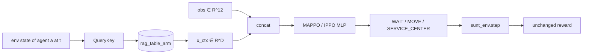

# 05 — LLM and RL Integration Strategies

> Workstream E. **[V]** = verified, **[I]** = assessment or recommendation, **[Q]** = open question. Literature references point to `03_literature_review.md`.

## 1. Constraints that decide the comparison [V]

- The BusEnv policy is a MARLlib **MLP on `Box(12)`** (`train_marllib.py:336`, `core_arch="mlp"`). It cannot read text.
- Training runs **10 Ray workers × 2 CPUs** for 200k timesteps with 25 agents (`train_marllib.py:342–347`), about 15–25 min per run. One run makes at least 200k agent-steps of observation queries.
- The runtime is **Python 3.8 / torch 1.9 / numpy 1.20** (doc 01 §1). RL-Chunk, MA-Chunk (gymnasium/SB3 2.x), sentence-transformers and current LLM SDKs need Python ≥ 3.9 (doc 02 §3.3).
- **Each query's information is fully determined by a discrete key** (doc 02 §5, doc 04 §4), so anything computed from the key can be cached.

## 2. Options compared

| | **1. Observation augmentation** (retrieval → features) | **2. LLM contextual processing** (offline LLM → structured features) | **3. LLM decision assistance** (LLM recommends, RL acts) | **4. Hierarchical** (LLM/planner sets goals, RL executes) |
|---|---|---|---|---|
| What reaches the policy | D numeric features per agent per step | D′ features produced by the LLM from the selected chunks (+ GTFS stop names), cached per key | a recommended action or prior, e.g. as an observation feature or a logit bias | goal or option per agent, plus a goal-conditioned policy |
| Expected benefit | Medium. Look-ahead demand and travel time that the 12-D observation lacks (doc 01 §6) | Uncertain. The LLM can only recombine what is in the chunks, plus world knowledge (e.g. "terminal", "hospital" in stop names), which carries a hallucination risk | Low to medium for holding decisions; the LLM has no edge over a learned holding policy in a dense, fast loop | Unknown; designed for long horizons and sparse rewards, which BusEnv does not have |
| Changes in BusEnv | **Wrapper only** (doc 04 §8) | Wrapper only (same table format) | Wrapper plus either an action-masking/logit hook or an extra feature; online LLM calls unless cached | New action/goal space, a new policy architecture in MARLlib, changes to the reward |
| Compatible with the MARLlib pipeline | **Yes, unchanged** | **Yes, unchanged** | Partly (feature form yes; logit bias needs a custom model) | No (custom model and training loop) |
| Online latency | µs (lookup) | µs (lookup) | 0.1–2 s per call if online (200k+ calls per run would be infeasible); µs if cached | high |
| Compute cost | Offline minutes, CPU | Offline: about 105k keys × 1 LLM call; deduplicate on the selected-chunk set (expect far fewer unique prompts); cost depends on model; cache forever | very high online, or same as option 2 if cached | very high |
| Reproducibility | Exact (file hash) | Exact **once cached** (fix the model id and temperature 0, and store the prompts and outputs) | Poor online (API drift) | Poor |
| Training stability | Neutral to positive (stationary features) | Same as option 1 | Risk: non-stationary or noisy recommendations | Risk: two learners |
| Literature precedent | R2A (Goyal 2022), large-scale retrieval for RL (Humphreys 2022): retrieval output as policy input. Dong & Gayah 2026: **offline** LLM stop embeddings as extra RL observation for bus holding, with no LLM at run time | Dong & Gayah 2026 (offline LLM → fixed features); TransitGPT (LLM over GTFS) | iLLM-TSC, LLMLight, REG-TSC: LLM in the decision loop for **signal control** | none for transit found |

## 3. Recommendation

1. **Phase 1 = Option 1 only.** Retrieval → adaptive selection (RL-Chunk and MA-Chunk, as two arms) → fixed featurizer → lookup table → observation wrapper. **No LLM.** This option alone answers the main research question: does adaptive retrieval improve MARL transit control? It is the only option that keeps all of these at once: the policy, the action space, the reward, the MARLlib pipeline and exact reproducibility.
2. **Phase 2 = Option 2, only if Phase 1 shows a signal.** For each unique selected-chunk set, render the chunks (doc 04 §5.1) together with the GTFS stop and route names into a fixed prompt. Ask an LLM for a **JSON with a fixed schema**, for example:
   - `crowding_risk` ∈ {0,1,2,3}
   - `delay_risk` ∈ {0,1,2,3}
   - `peak_ahead_hops` ∈ [0, H]
   - `confidence` ∈ [0, 1]

   Validate the JSON, map it to numbers, and append it as D′ features. Do this **offline and cached**, keyed by the hash of the selected-chunk set. Measure tokens, cost, the fraction of invalid outputs, and agreement with the numeric features, which serves as a hallucination check.
   - The scientific question for Phase 2 is narrow: does LLM recombination add anything beyond the numbers it was given?
   - The ablation must include **"LLM features only"** and **"numeric + LLM"** against **"numeric only"**.
3. **Option 3** is deferred. If tried at all, use the cached form (the recommendation becomes a feature), which reduces it to option 2.
4. **Option 4** is out of scope. It changes the research objective.

## 4. Why not put the LLM in the hot loop (quantified) [I]

- One run is 200k env steps × 25 agents = 5M agent-observations.
- At even 100 ms per LLM call, that is about 139 h of LLM time per run, before multiplying by arms (7) × algorithms (2) × seeds (5).
- Caching per key reduces this to at most about 105k unique calls **in total, across all runs**, and deduplicating on selected-chunk sets reduces it further.

## 5. How retrieval results influence the agent (summary)

The retrieved context changes **only the observation**. The reward, transition and action space are unchanged. Any improvement in reward therefore comes from **better-informed decisions**, not from a changed objective. That makes the causal claim of the experiment clean.

## 6. Open questions

- **[Q]** If Phase 2 runs, which LLM and what budget? Is a local open-weights model preferred for reproducibility, given that the user's workspace already runs local models (`/mnt/ssd1/rafael/hf-cache`)?
- **[Q]** Should GTFS `stop_name` text be included in the Phase 2 prompt? It is the only field that could add world knowledge, and also the main hallucination risk.
